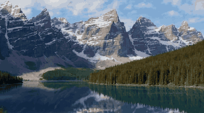
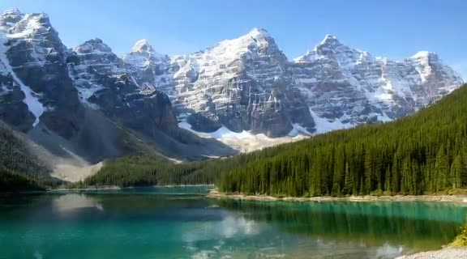
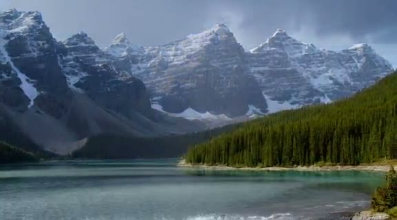
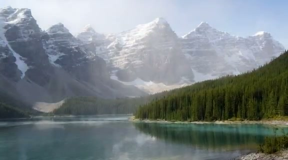
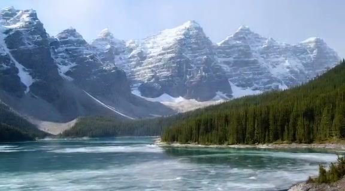

<div align="center">

# 🪟 Living Window — The View Outside, As You Say It

**A wallpaper that listens. Say "heavy rain, mist rolling in" and the scenery melts there — then holds still.**

English · [简体中文](README.zh-CN.md)

   



<sub>Real output: one still photo, changing with a sentence. (Lake photo: Moraine Lake, public domain, via Wikimedia Commons.)</sub>

</div>

## What is it?

A real-time "virtual window" wallpaper. You keep a fixed scene — a lake, a room window — and tell it what the weather, season or time of day should be. The picture **smoothly transitions from the current state to what you asked for, then holds** (with gentle motion). Your next sentence continues from the new state.

The research question behind it: *can an open-source real-time video-generation stack, on one modest GPU, make a still landscape "alive" and steer it with prompts — without breaking the composition?*

| Clear (start) | Rain | Fog | Snow |
|:--:|:--:|:--:|:--:|
|  |  |  |  |

## What was built and learned

Stack: **[Scope](https://github.com/daydreamlive/scope) + LongLive (Wan2.1-T2V-1.3B based) + VACE**, running as a Slurm job on one **A40 (46 GB)**; a small local bridge server turns the stream into JPEG frames for a browser "wallpaper" page.

**Stage 1** — can it run? Yes: LongLive ≈ 7.6 FPS at 576×320, 17.9 GB VRAM, 60 s without drift. Using a still PNG as anchor locks colour (the lake stays turquoise in the rain).

**Stage 2** — lock *structure*, not pixels. Compared six approaches:

| Approach | Still the same picture | Look can change | Smooth | Works on any image |
|---|---|---|---|---|
| Original as V2V anchor | ✓ | ✗ colour locked | hard cut | ✓ |
| Depth map only | ✗ | ✓ | hard cut | ✓ |
| Mask inpainting | ✓ per pixel | only white regions | seam per patch | needs segmentation |
| **Depth + original reference image + prompt ramp (4/8 steps)** | **✓** | **✓** | **✓ no hard cut** | **✓** |

Chosen: **auto depth + original as reference + gradual prompt transition.** Web prototype works: change starts in 3.5–6.6 s, finishes and holds in 18–28 s.

**Unsolved:** the model can't paint raindrops / snowflakes / ripples → a procedural weather-effects overlay handles those; transitions are slowish (≈4.2 FPS); only tested on one landscape; prompts are keyword rules, not yet an LLM.

## Progress

| Item | State |
|---|---|
| A40 + Scope + LongLive running | ✅ |
| PNG anchor → depth + reference-image pipeline with gradual transition | ✅ |
| Web prototype (prompt layer, bridge server, wallpaper canvas, weather overlay) | ✅ prototype |
| LLM prompt layer & VLM scene description | ⬜ |
| Relay reference frames, auto water-mask for ripples | ⬜ |
| RIFE frame interpolation / faster denoise steps / stronger GPU | ⬜ |
| First-and-last-frame (FFLF) transition & image-edit target frame | ⬜ designed, untested |
| More scenes (sea, city, room interior) | ⬜ |
| Desktop wallpaper client | ⬜ |

**Paused on 2026-10-29** — GPU exploration on the school cluster is on hold; resume steps are in `docs/` and `app/README.md`.

## Roadmap

1. Switch to *target-image + first/last-frame* transitions; loop the held scene locally so the GPU is idle most of the time.
2. LLM prompt layer + automatic scene understanding for arbitrary photos.
3. Overlay effects driven by segmentation; stronger / commercial model comparison (see research notes).
4. Real wallpaper client for macOS/Windows; extend to animals, aquariums, living photos.

## Repository

```text
app/        web prototype: bridge server, prompt layer, wallpaper page
scripts/    experiment runners, Slurm helpers, Scope local patches
assets/     test scene (Moraine Lake) and derived depth/mask videos
docs/       screenshots and demo media
*.md        research & experiment notes (Chinese)
```

Research notes: [Tech selection & measurements](技术选型-虚拟窗景.md) · [Stage 1 plan](阶段一-探索计划.md) · [Stage 2 directions](阶段二-改进方向.md) · [Commercial APIs & FFLF](调研-商用API与首尾帧架构.md) · [Stronger models & HD](调研-更强模型与高清方案.md) · [Research directions](调研方向.md).

## Running it

Needs a GPU host running Scope (see `app/README.md` for the Slurm job, SSH tunnel and bridge server steps), then `python3 app/server.py` and open `http://127.0.0.1:8765`. Reference result videos are not stored in this repo (they are large).

## License

[MIT](LICENSE) © 2026 Zeran Wang. Scope, LongLive, Wan2.1 and VACE keep their own licences.
