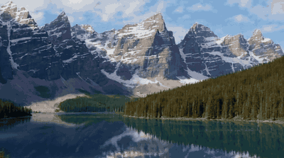
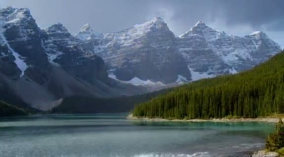
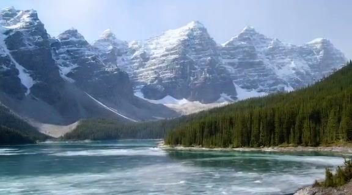

<div align="center">

# 🪟 活窗 · 窗外，由你说了算

**会听话的壁纸。说一句"下大雨，雾气弥漫"，窗外就慢慢变过去，然后定住。**

[English](README.md) · 简体中文

   



<sub>真实输出：一张静态照片，跟着一句话变化。（湖景：Moraine Lake，公有领域，来自维基共享资源。）</sub>

</div>

## 这是什么

一个实时"虚拟窗景"壁纸。保持一个固定场景（一片湖、一扇窗），你告诉它想要的天气、季节或时间，画面会**从当前状态平滑过渡到你要的样子，然后定住**（带轻微动态）；下一句话再从新状态继续。

背后的研究问题：*用开源实时视频生成方案，在一张普通 GPU 上，能不能让一张静态风景"活起来"，并用提示词控制它，同时不破坏构图？*

| 晴天（起点） | 下雨 | 起雾 | 下雪 |
|:--:|:--:|:--:|:--:|
|  |  |  |  |

## 做了什么、学到了什么

技术栈：**[Scope](https://github.com/daydreamlive/scope) + LongLive（基于 Wan2.1-T2V-1.3B）+ VACE**，作为 Slurm 作业跑在一张 **A40（46 GB）** 上；本机一个小桥接服务把视频流转成 JPEG 帧，喂给浏览器里的"壁纸"页面。

**阶段一**：能不能跑？能。LongLive 在 576×320 约 7.6 FPS，显存 17.9 GB，60 秒无漂移。但用静态 PNG 当锚点会把颜色锁死（下雨时湖面仍是青绿色）。

**阶段二**：该锁的是"结构"，不是"像素"。对比六种做法：

| 做法 | 还是这张图 | 外观能变 | 平滑 | 对任意图通用 |
|---|---|---|---|---|
| 原图做 V2V 锚点 | ✓ | ✗ 颜色锁死 | 硬切 | ✓ |
| 只用深度图 | ✗ | ✓ | 硬切 | ✓ |
| 遮罩修补 | ✓ 逐像素 | 只有白色区域能变 | 每块一道接缝 | 需要分割 |
| **深度图 + 原图参考图 + 提示词渐变（4/8 步）** | **✓** | **✓** | **✓ 无硬切** | **✓** |

最终方案：**自动深度图 + 原图做参考 + 提示词渐变。** 网页原型已跑通：提出要求后 3.5–6.6 秒开始变化，18–28 秒过渡完成并定住。

**尚未解决**：模型画不出雨丝、雪花、涟漪 → 用程序化天气特效层补；过渡偏慢（约 4.2 FPS）；只在一张风景图上测过；提示词还是关键词规则，没接 LLM。

## 目前进度

| 事项 | 状态 |
|---|---|
| A40 + Scope + LongLive 跑通 | ✅ |
| PNG 锚点 → 深度图 + 参考图 + 渐变过渡 | ✅ |
| 网页原型（提示词层、桥接服务、壁纸画布、天气特效层） | ✅ 原型 |
| LLM 提示词层与视觉语言模型自动描述场景 | ⬜ |
| 接力参考图、自动水面分割做涟漪 | ⬜ |
| RIFE 补帧 / 减少去噪步数 / 更强 GPU | ⬜ |
| 首尾帧（FFLF）过渡与图像编辑目标帧 | ⬜ 已设计，未实测 |
| 更多场景（海边、城市、房间内景） | ⬜ |
| 桌面壁纸客户端 | ⬜ |

**2026-10-29 暂停**：学校集群上的 GPU 探索暂停，恢复步骤见 `app/README.md` 和调研文档。

## 路线图

1. 改为"目标图 + 首尾帧"过渡；定住后本地循环播放，GPU 大部分时间空闲。
2. LLM 提示词层 + 对任意照片自动理解场景。
3. 用分割驱动特效层；对比更强/商用模型（见调研）。
4. macOS / Windows 真正的壁纸客户端；扩展到动物、鱼缸、照片复活。

## 目录

```text
app/        网页原型：桥接服务、提示词层、壁纸页面
scripts/    实验脚本、Slurm 辅助、Scope 本地补丁
assets/     测试场景（Moraine Lake）与衍生深度/遮罩视频
docs/       截图与演示媒体
*.md        调研与实验笔记（中文）
```

笔记：[技术选型与实测](技术选型-虚拟窗景.md) · [阶段一计划](阶段一-探索计划.md) · [阶段二改进方向](阶段二-改进方向.md) · [商用 API 与首尾帧架构](调研-商用API与首尾帧架构.md) · [更强模型与高清方案](调研-更强模型与高清方案.md) · [调研方向](调研方向.md)。

## 运行

需要一台运行 Scope 的 GPU 主机（Slurm 作业、SSH 隧道、桥接服务步骤见 `app/README.md`），然后 `python3 app/server.py`，浏览器打开 `http://127.0.0.1:8765`。体积较大的结果视频没有放进仓库。

## 许可证

[MIT](LICENSE) © 2026 Zeran Wang。Scope、LongLive、Wan2.1、VACE 遵循各自许可证。
